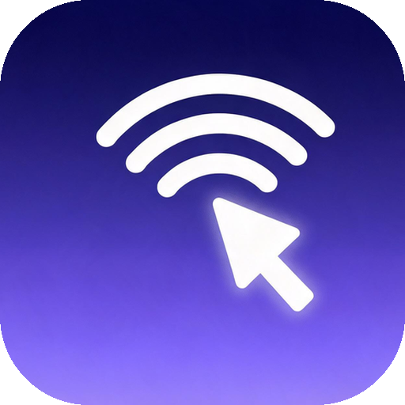

<p align="center">
  
</p>

<h1 align="center">WIME</h1>

<p align="center">
  <b>把手机变成电脑的无线鼠标和键盘</b><br>
  电脑端一键启动，手机扫码或自动发现，无需装驱动、无需数据线。
</p>

<p align="center">
  
  
  
  
</p>

<p align="center">电脑端是一个 Python 服务，手机通过同一局域网访问网页或安装 APK 连接，即可获得一块触控板和实时输入框。中文输入走剪贴板粘贴，打字几乎无延迟。</p>

---

## 功能特性

| 功能 | 说明 |
| --- | --- |
| 触控板 | 单指拖动移动指针，单击左键，双指单击右键，双指滑动滚轮 |
| 实时输入 | 手机键盘边打边传，输入框不清空，输入法联想正常可用；回车发送并换行 |
| 灵敏度调节 | 触控板左上角设置里可分别调鼠标、滚轮灵敏度，保存在手机本地 |
| 全屏 | 右下角全屏按钮，只留触控板，横竖屏切换不断连 |
| 自动发现 | 手机 App 广播探测，电脑回应地址：一台直接连，多台列出让用户选 |
| 扫码连接 | 启动时弹二维码窗口，手机扫码打开控制页（可在配置里关闭） |
| 托盘运行 | 后台常驻托盘，右键可打开控制页、查看二维码、退出 |
| 开机自启 | 配置 `auto_start = true` 写入注册表，开机自动在托盘运行 |
| 单实例 | 重复双击不会起第二个进程，也不会再报端口占用 |

## 工作原理

```
┌────────────┐   HTTP POST /api (JSON)    ┌──────────────┐
│  手机浏览器 / APK  │ ─────────────────────────> │  Python 服务端  │
│ 触控板 + 输入框   │                            │  8888 端口     │
└────────────┘                            └──────┬───────┘
        │                                        │
        │  UDP 广播 WIME_DISCOVER :9999           ├─> pyautogui   鼠标/键盘
        └───────────────────────────────────────>│
                                                 └─> pyperclip   中文输入(粘贴)
```

- 鼠标与滚轮：手机端节流后直接发 `move` / `scroll` 指令
- 文字输入：对比上一次输入内容，只把新增/删除的差异发过去，80ms 防抖合并后再发
- 中文输入：服务端写剪贴板 + `Ctrl+V`，用锁保证复制粘贴原子完成，避免丢字乱序
- 自动发现：手机向 `255.255.255.255:9999` 和子网广播，电脑回包带 `ip` / `port` / `name`

---

## 目录结构

```
WIME/
├─ main.py                 # 入口（源码运行与 exe 打包都用它）
├─ requirements.txt        # 运行与打包依赖
├─ build_exe.py            # 打包 Windows exe
├─ phone_mouse/
│  ├─ server.py            # HTTP 服务、UDP 发现、托盘、开机自启
│  ├─ index.html           # 手机遥控页（触控板 + 输入框）
│  ├─ config.ini           # 配置文件（首次运行自动生成带注释的模板）
│  └─ tray.png             # 托盘图标
└─ app/                    # Android APK（Java WebView 壳 + 内置启动页）
   ├─ WIME.apk             # 构建产物，可直接安装
   ├─ build.py             # 纯 Python 构建 APK，无需 Android Studio
   └─ android/             # 清单、Java 源码、资源、jsQR 与启动页
```

## 快速开始

### 1. 电脑端

```bash
pip install -r requirements.txt
python main.py
```

首次启动会生成 `phone_mouse/config.ini`。默认不弹二维码，程序缩到系统托盘，手机打开 App 会自动发现电脑。

> 首次运行时 Windows 会询问网络权限，请勾选「专用网络」并允许，否则手机连不上。若手机仍打不开页面，检查 8888（TCP）和 9999（UDP）是否被防火墙拦截。

### 2. 手机端

**方式一：装 APK（推荐）**

安装 [app/WIME.apk](app/WIME.apk)，打开后自动搜索局域网内的电脑：只有一台就直接连接，多台则列出主机名让你选择；也可以点「扫码」扫电脑上的二维码。

**方式二：浏览器直连**

在手机浏览器打开 `http://电脑IP:8888`，把 `show_qr` 设成 `true` 后启动可直接扫码进入。

### 3. 手势

| 操作 | 效果 |
| --- | --- |
| 单指拖动 | 移动鼠标 |
| 单指轻点 | 左键单击 |
| 双指轻点 | 右键单击 |
| 双指滑动 | 滚轮上下滚动 |
| 底部输入框 | 实时输入到电脑，回车发送 |
| 左上角齿轮 | 调鼠标 / 滚轮灵敏度 |
| 右下角方框 | 全屏（隐藏输入栏，只留触控板） |

---

## 配置说明

`config.ini` 与 exe 放在同一目录（源码运行时在 `phone_mouse/` 下）：

```ini
[server]
# HTTP 服务端口, 手机连接时用这个端口
port = 8888
# 启动时是否弹出二维码窗口
show_qr = false
# 是否开机自动启动 (仅打包后的 WIME.exe 生效)
# 修改后需重启 WIME.exe 才生效
auto_start = false
```

| 配置项 | 默认值 | 说明 |
| --- | --- | --- |
| `port` | `8888` | 手机连接用的端口，被占用时改这里 |
| `show_qr` | `false` | `true` 启动弹二维码窗口，关闭窗口即退出 |
| `auto_start` | `false` | `true` 写入开机启动项（注册表 Run），仅 exe 生效 |

配置只在文件不存在时按模板生成，之后不会覆盖，注释和你的修改都会保留。

## 打包

### Windows exe

```bash
pip install pyinstaller
python build_exe.py
```

产物为 `dist/WIME.exe`（单文件，约 17 MB），图标取自 `app/icon_square_round.png`。首次运行会在 exe 旁边生成 `config.ini`。

> 单文件打包在任务管理器里会看到两个同名进程（解压父进程 + 实际子进程），属于同一个实例；重复双击不会再新增。

### Android APK

```bash
python app/build.py
```

脚本用 `aapt2 / javac / d8 / zipalign / apksigner` 直接构建，首次运行会自动下载构建工具（约 100 MB），不需要 Android Studio、gradle 或 WSL。产物为 `app/WIME.apk`。

## 常见问题

**手机搜不到电脑？**
确认手机和电脑在同一个 Wi-Fi（不要开路由器 AP 隔离），电脑端防火墙放行 9999/UDP 和 8888/TCP；部分校园网、公司网禁止广播，此时用扫码或手动输入 `http://电脑IP:8888`。

**能连上但打不了字？**
中文输入依赖剪贴板粘贴，请确认电脑端进程仍在运行；输入框只发送差异内容，若中途电脑端重启，手机上重新聚焦输入框即可。

**托盘图标找不到？**
Windows 默认把新图标收进右下角「显示隐藏的图标」里，点开折叠区拖出来固定即可。

**双击没反应？**
程序只允许一个实例，已在运行时再次双击会静默退出，去托盘图标里打开控制页即可。

**ATV / 电视盒子能用吗？**
移动端只依赖浏览器或 WebView，能访问局域网并支持输入框的浏览器即可；APK 最低要求 Android 5.0。

---

## 依赖

| 包 | 用途 |
| --- | --- |
| pyautogui | 鼠标移动、点击、滚轮、按键 |
| pyperclip | 剪贴板复制，用于中文输入 |
| qrcode | 生成启动二维码 |
| Pillow | 二维码缩放、托盘图标处理 |
| pystray | 系统托盘常驻 |
| pyinstaller | 仅打包 exe 时需要 |
